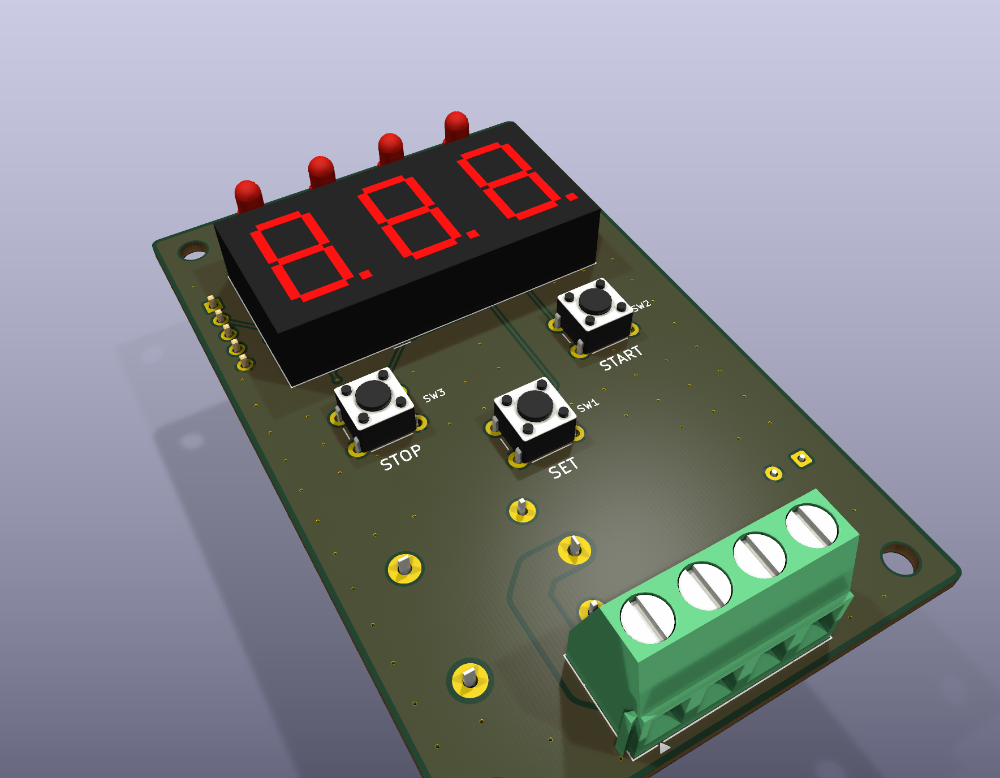

# CYTM Digital Timer

24 VDC cyclic relay timer: relay ON for a set time, OFF for a set time, repeat.
Nuvoton MG51FB9AE (8051) MCU, 3-digit 7-segment display, SET / START / STOP keys.

| Folder | What |
|--------|------|
| `Final/` | Production firmware `5-26.c` (IAR). `5-26.a51` is an Intel HEX image built from an earlier version of the source; rebuild before flashing. |
| `hardware/` | PCB, generated from scratch with KiCad 10 + Python. See [hardware/README.md](hardware/README.md). |
| `timer_sdcc/` | SDCC display test (cycles 0-9 on all digits). |
| `resources/` | Photos of the previous board, enclosure and a reference film panel. |
| `docs/` | Design spec and build plan for the PCB. |

## Firmware

Settings: hold SET 1 s, choose ON unit (UP = min, DOWN = sec), set ON value, choose OFF unit, set OFF value,
SET saves to flash and restarts the cycle. 30 s without a key cancels. Hold START + STOP 2 s shows the
manufacturing date. Calibrate the clock with `CAL_MS` at the top of `5-26.c`.

Build needs the Nuvoton MG51 BSP headers (`numicro_8051.h`), not included here:
https://github.com/OpenNuvoton/MG51BSP

## PCB

50 x 80 mm, 2 layers. Gerbers, BOM, pick-and-place and 1:1 films are in `hardware/output/`.
Rebuild and re-check everything with `python hardware/scripts/build.py`.
